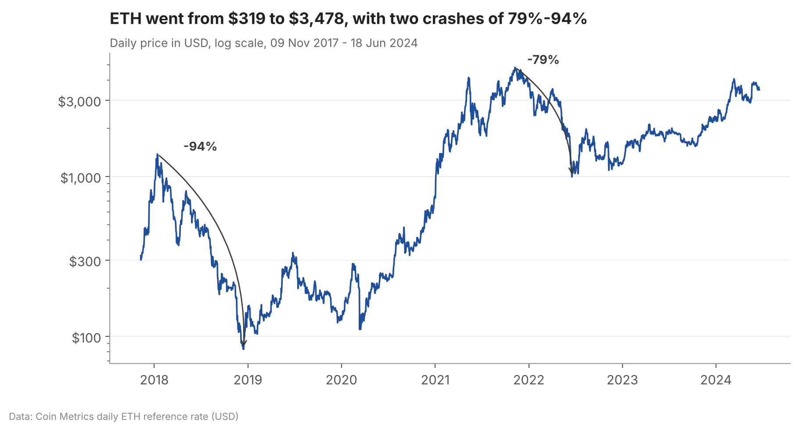
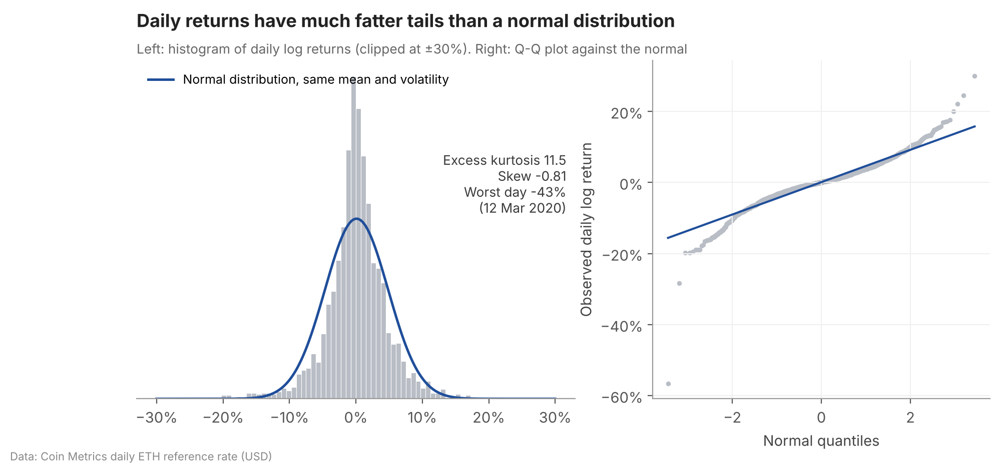
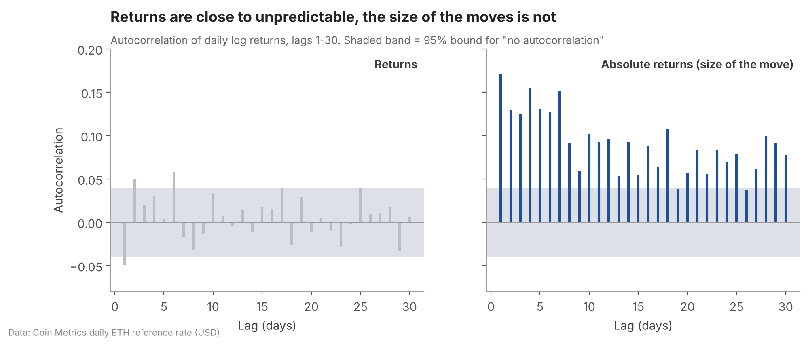
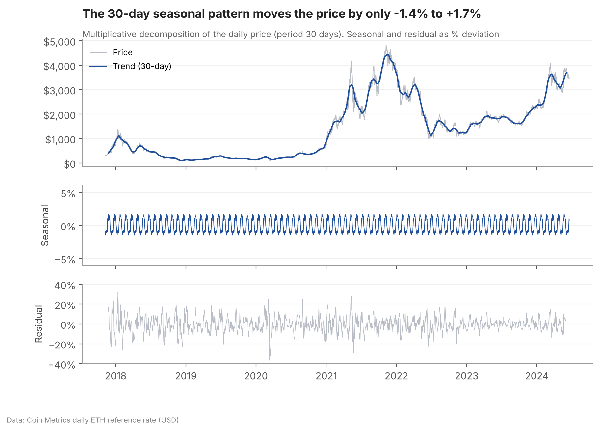
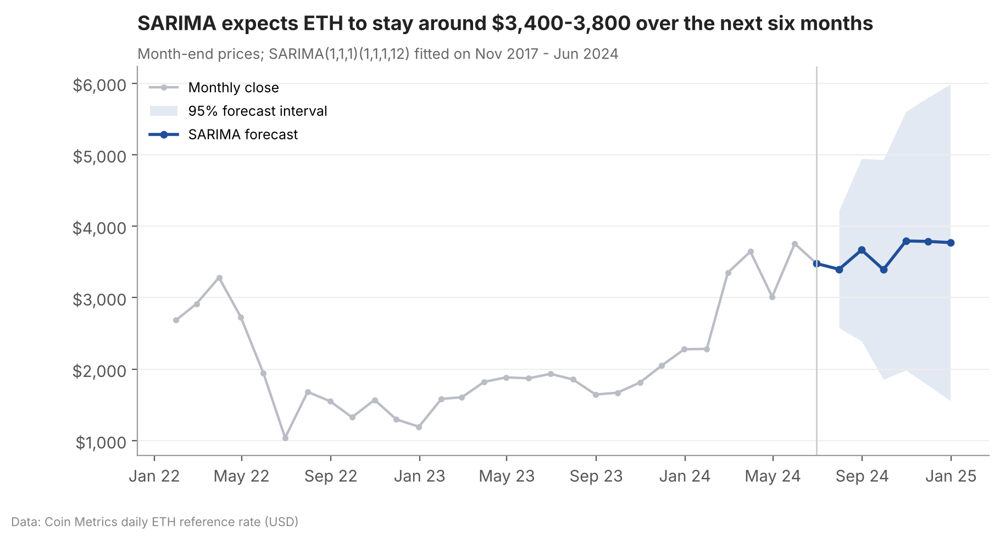
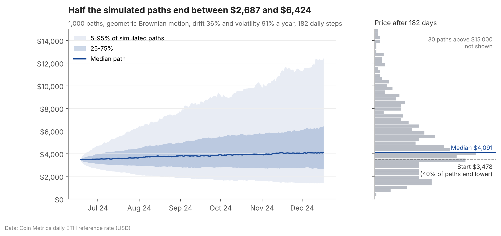

# Time-Series Analysis and Price Prediction of Ethereum

This is my seminar project from 2024 at Otto von Guericke University Magdeburg: "Time-Series Analysis and Price Prediction of a Financial Asset using a SARIMA Model and Monte Carlo Simulation in Python".

The idea was to take one volatile asset, Ethereum (ETH/USD), and go through the standard time-series toolkit step by step: distribution, stationarity, autocorrelation and seasonality. Then I forecast the price six months ahead in two different ways, with a SARIMA model and with a Monte Carlo simulation.

## Data

There are 2,414 daily prices, from 9 November 2017 to 18 June 2024. Over that time ETH went from $319 to $3,478, with two crashes of 79% and 94% along the way.



The prices are the Coin Metrics daily reference rate in USD, from their free community data on GitHub.

## What the data looks like

**Returns are far from normal.** The average daily log return is +0.10%, with a standard deviation of 4.75%. ETH trades every day, so I annualise with 365 days, not the 252 trading days used for stocks. That gives 36% a year and a volatility of 91%. The distribution has a sharp peak and fat tails, with an excess kurtosis of 11.5. The worst day was 12 March 2020, at −43%. The Jarque-Bera test rejects normality with a p-value of practically zero.



**Prices are not stationary, returns are.** The Augmented Dickey-Fuller test can't reject a unit root for the price (p = 0.71), but rejects it clearly for daily returns (test statistic −16.9). That's why the models work with returns or differenced prices.

**Returns are almost unpredictable, the size of the moves is not.** Daily returns show only tiny autocorrelations; three of the first 30 lags just cross the significance band. Absolute returns are a different story. Their autocorrelation is 0.17 at lag 1 and still 0.08 after 30 days. Calm and stormy periods cluster.



**There is no real seasonality.** The multiplicative decomposition with a 30-day period finds a seasonal component of only −1.4% to +1.7%. With a typical daily move of almost 5%, that's noise. A Kruskal-Wallis test also finds no difference between calendar months (p = 0.71).



## Forecasts

### SARIMA

I fitted a SARIMA(1,1,1)(1,1,1,12) on month-end prices and forecast the six months from July to December 2024. The model expects the price to stay around $3,400–3,800.



| Month end (2024) | Forecast | 95% interval |
|---|---|---|
| July | $3,398 | $2,578 – 4,217 |
| August | $3,668 | $2,391 – 4,945 |
| September | $3,393 | $1,856 – 4,931 |
| October | $3,794 | $1,986 – 5,601 |
| November | $3,787 | $1,778 – 5,797 |
| December | $3,771 | $1,558 – 5,984 |

The interval widens quickly. By December it runs from about $1,600 to $6,000, which shows how little a price model alone can say about ETH six months out.

This SARIMA is a practical test of how such a model works on a crypto asset. In real use it would need more adjustment: choosing the orders with information criteria, checking the residuals, and comparing it with simpler models. With only 80 monthly observations and no clear seasonality, a plain ARIMA might well do as well.

### Monte Carlo simulation

The simulation models the price as a geometric Brownian motion. Drift and volatility come from the historical daily log returns. I simulated 1,000 paths of 182 daily steps (half a year), starting from $3,478.



- **Median end price:** $4,091. The mean is $5,150, pulled up by a few very high paths.
- **Spread:** half of the paths end between $2,700 and $6,400. The middle 90% end between $1,400 and $12,400.
- **Downside:** 40% of the paths end below the starting price.

The drift is the historical average, which for 2017–2024 is high. It's the strongest assumption in the simulation. The constant volatility also ignores the clustering seen in the autocorrelation chart.

### Comparing the two

Both methods point slightly upwards, but the more useful result is the uncertainty around the forecast. SARIMA gives one path with a widening band. The Monte Carlo simulation shows the whole distribution of possible prices, which suits an asset with 90% annual volatility better.

The original goal of the seminar was to price an out-of-the-money call option on ETH with these forecasts. I left that part out here, because the analysis and forecasting toolkit works on its own and can be reused for other assets.

## Files

| File | What it does |
|---|---|
| `ETH_Analysis.ipynb` | Step-by-step walkthrough with all outputs; it also saves the charts shown in this README |
| `data_loader.py` | Loads the daily prices from Coin Metrics and computes returns |
| `analysis.py` | Descriptive statistics, normality, stationarity, autocorrelation and seasonality tests |
| `forecasting.py` | SARIMA forecast and Monte Carlo simulation |
| `visualization.py` | All charts |
| `main.py` | Runs everything without the notebook, prints the results and saves the same charts |

## Running it

```bash
pip install -r requirements.txt
python main.py                       # results in the console, charts as PNG files in the same folder
jupyter notebook ETH_Analysis.ipynb  # the same analysis, step by step
```
